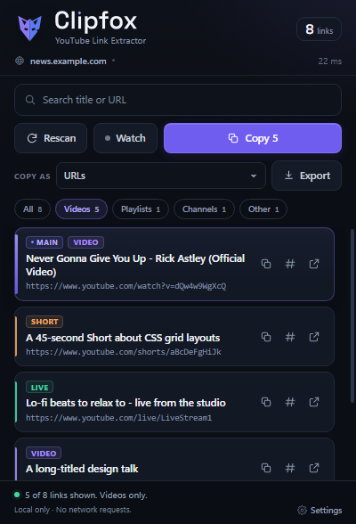

# Clipfox

**Find and extract YouTube links from any webpage.**

Clipfox is a Manifest V3 extension for Chrome, Edge, Brave, and other Chromium browsers. It finds every YouTube link the current page exposes — videos, Shorts, live streams, embeds, playlists, channels, and other YouTube URLs — and puts them in a compact, searchable popup. Playable video links are shown by default; switch to **All** to see playlists and channels.

> **Find the links. Clip the clutter.**



No build step. No framework. No external libraries. No network requests from the extension.

---

## Highlights

- **Click-to-scan** — Clipfox opens in a ready state. Nothing on the page is read until you press **Scan this page**. Use **Rescan** to refresh the results.
- **Main video detection** — the first embedded YouTube player is pinned to the top and marked with a violet **Main** badge. This is the important case on class pages such as Udvash, where the surrounding page can contain many unrelated YouTube links.
- **Watch mode** — while the popup is open, Clipfox checks the embedded player every 3 seconds and silently rescans when the player changes. A failed refresh keeps the previous results and retries later.
- **Copy formats** — URLs, Title + URL, Markdown, CSV, JSON, or bare video IDs. The same format is used by **Copy all**, **Copy N**, and **Export**.
- **Export** — download the current results as `.txt`, `.md`, `.csv`, or `.json` with a Clipfox host-and-date filename. No download permission is required.
- **Toolbar badge** — shows the number of links found on the last scanned tab in Clipfox violet. It clears when that tab navigates or closes and can be turned off in Settings.
- **Recognizes** watch pages, `youtu.be` links, Shorts, live URLs, embeds (including `youtube-nocookie.com`), playlists, channel/handle pages, anchors, iframes, page metadata, JSON-LD, and visible plain-text URLs.
- **Canonical output** — mobile/music hosts, embed forms, tracking parameters, and duplicate URLs collapse to one clean link.
- **Safe deduplication** — the same video in a watch, Shorts, live, and embed form becomes one result; genuinely different video IDs are never merged.
- **Videos first** — the popup opens on the **Videos** filter, which includes normal videos, Shorts, and live streams. Playlists, channels, and other YouTube pages are still extracted but stay out of the way until you choose **All** or their chip.
- **Search and filters** by title, URL, and category, with per-category counts.
- **Keyboard friendly** — `/` or `Ctrl+K`/`Cmd+K` focuses search, `Escape` clears it, `Ctrl+Shift+Y`/`Cmd+Shift+Y` opens the popup, and every control has a visible focus ring.
- **Honest states** for loading, empty results, protected pages, scan errors, no-match searches, stale pages, and large result sets.
- **Privacy-first permissions** — `activeTab`, `scripting`, `clipboardWrite`, and `storage` only. No host permissions, analytics, telemetry, remote code, or tracking.

---

## Install (unpacked)

### Chrome

1. Open `chrome://extensions`.
2. Turn on **Developer mode** (top-right).
3. Click **Load unpacked**.
4. Select this `yt-link-extractor` folder — the folder that contains `manifest.json`.
5. Pin **Clipfox** from the puzzle-piece menu if you want quick access.

### Microsoft Edge

1. Open `edge://extensions`.
2. Turn on **Developer mode** (left sidebar).
3. Click **Load unpacked**.
4. Select this `yt-link-extractor` folder.
5. Pin **Clipfox**.

### Brave

1. Open `brave://extensions`.
2. Turn on **Developer mode**.
3. Click **Load unpacked**.
4. Select this `yt-link-extractor` folder.
5. Pin **Clipfox**.

After editing any source file, click the reload button for Clipfox on the extensions page, then reopen the popup.

---

## Use

1. Open a normal `http://` or `https://` page that contains YouTube links.
2. Click the Clipfox toolbar icon (or press `Ctrl+Shift+Y` / `Cmd+Shift+Y`). The popup opens in a ready state and does not read the page yet.
3. Click **Scan this page**. Clipfox reads the current tab and lists the YouTube links it can find.
4. The list opens on **Videos** only. Choose **All** (or Playlists / Channels / Other) to include non-video YouTube links.
5. Narrow the list with search, or choose a category chip.
6. Pick a **Copy as** format, then use **Copy all** / **Copy N** to copy the current filtered matches, or **Export** to save them as a file.
7. Use the copy icon on a card to copy that card's URL. Use the `#` icon to copy its 11-character video ID. Click the URL or the open icon to open it in a new tab.
8. Press **Watch** to refresh automatically when the embedded player changes. Press **Watching** again to stop.
9. Click **Rescan** after the page changes. If the page finishes loading while the popup is open, the footer warns that the scan is stale.

Clipfox deliberately scans on demand rather than reading every page automatically. That keeps the permission surface small and makes it clear when page content is being read.

### Keyboard shortcuts

| Shortcut | Action |
| --- | --- |
| `Ctrl+Shift+Y` / `Cmd+Shift+Y` | Open the Clipfox popup |
| `/` | Focus the search field |
| `Ctrl+K` / `Cmd+K` | Focus the search field |
| `Escape` | Clear the search when the search field is focused |
| `Tab` / `Shift+Tab` | Move through controls and cards |
| `Enter` / `Space` | Activate the focused button or link |

The popup shortcut can be changed on the browser's extension shortcuts page.

---

## Copy formats and export

| Format | Output | Export extension |
| --- | --- | --- |
| **URLs** | One canonical URL per line | `.txt` |
| **Title + URL** | `Title — URL` per line | `.txt` |
| **Markdown** | `- [Title](URL)` per line | `.md` |
| **CSV** | Header row plus `Title,URL,Category` | `.csv` |
| **JSON** | Array of `title`, `url`, `category`, `main` | `.json` |
| **Video IDs** | One 11-character ID per line; playlists and channels are skipped | `.txt` |

**Copy all** and **Export** operate on the full filtered result set, not just the 100 cards currently rendered. Per-card copy always copies that card's URL. The selected format is remembered in `chrome.storage.sync` and can be changed from the popup or the Settings page.

Export filenames use the page host and the current date:

```text
news.example.com-clipfox-2026-10-25.json
clipfox-2026-10-25.txt
```

The host is omitted when the page has no usable hostname. CSV fields containing commas, quotes, or line breaks are quoted and escaped. JSON is pretty-printed. Markdown brackets and closing parentheses in URLs are escaped.

---

## Main video and Watch mode

### Main video

When the page contains an embedded YouTube player, the first embedded video is treated as the page's main video:

- It is moved to the top of the results.
- It gets a violet **Main** badge and a highlighted card.
- If the same video also appears as a normal anchor, the embed source wins during deduplication so the card is still recognized as the main video.

This is a heuristic, not a guarantee. A page with several embeds uses the first one. A page whose main player is inside a cross-origin frame still works when the iframe's `src` or `data-src` exposes a YouTube URL.

### Watch mode

Watch mode is designed for class players and other pages that replace the embedded video without a full navigation:

- It checks the embedded player every 3 seconds with a lightweight probe that only reads player elements.
- The first probe establishes a baseline; later changes trigger a silent full rescan.
- On success, the results update and a toast confirms the change.
- On failure, the previous results stay on screen, the footer shows **Watch paused**, and the next attempt is delayed for 10 seconds.
- It stops when the popup closes or when you press **Watching** again. A failed refresh keeps it enabled and retries, unless the page becomes unavailable before any results were captured.
- **Start Watch automatically** in Settings turns it on after a successful scan. A manual stop is respected until the popup is reopened.

Watch mode does not run in the background. It only polls while the popup is open, so it adds no persistent timers or browsing history.

---

## Toolbar badge

The badge shows the number of unique links found on the last scanned tab. Counts above 999 display as `999+`. The badge uses Clipfox violet `#6f5df0`.

- It is set only after a scan, and only for that tab.
- It clears as soon as that tab starts navigating, changes URL, or closes.
- Turning off **Show link count on the toolbar icon** in Settings clears badges from open tabs and suppresses new ones.
- Badge text is per-tab; opening a different tab does not show the previous tab's count.

The background service worker exists only to clear stale badges and set the badge color. It does not scan pages, make network requests, or keep history.

---

## Settings

Open Settings from the popup footer or the extensions page. The page is a normal extension tab.

| Setting | Default | Effect |
| --- | --- | --- |
| **Default format** | URLs | Format used by Copy all, Copy N, and Export |
| **Start Watch automatically** | Off | Starts Watch after a successful scan |
| **Show link count on the toolbar icon** | On | Enables the per-tab badge |

Settings are stored in `chrome.storage.sync` with safe defaults. If sync is unavailable or a sync write fails, the extension falls back to `chrome.storage.local` and reports that it saved locally; if storage is unavailable entirely, it keeps working with defaults and shows an explanation on the Settings page. **Reset to defaults** restores all three settings.

---

## What it recognizes

| Input | Output |
| --- | --- |
| `youtube.com/watch?v=VIDEOID` | `https://www.youtube.com/watch?v=VIDEOID` |
| `youtu.be/VIDEOID` | `https://www.youtube.com/watch?v=VIDEOID` |
| `youtube.com/shorts/VIDEOID` | `https://www.youtube.com/shorts/VIDEOID` |
| `youtube.com/live/VIDEOID` | `https://www.youtube.com/live/VIDEOID` |
| `youtube.com/embed/VIDEOID`, `/v/VIDEOID` | `https://www.youtube.com/watch?v=VIDEOID` |
| `youtube-nocookie.com/embed/VIDEOID` | `https://www.youtube.com/watch?v=VIDEOID` |
| `m.youtube.com`, `music.youtube.com` watch URLs | Canonical `www.youtube.com/watch` URL |
| `youtube.com/playlist?list=LISTID` | Playlist root, without tracking parameters |
| `youtube.com/@handle`, `/channel/ID`, `/c/name`, `/user/name` | Channel root |
| `youtube.com/results?...`, `/hashtag/...`, home, other paths | **Other** category, cleaned URL |
| Relative, protocol-relative, and escaped URLs | Resolved against the page URL |
| `/redirect?q=...` and `/attribution_link?u=...` | Destination extracted (one retry level) |
| Iframe `src` / `data-src`, `embed`, `object`, `video`, `source` | Detected from the element attributes |
| `og:title`, `twitter:title`, canonical/alternate links, JSON-LD | Used for URLs and titles |
| Visible URL text such as `https://youtu.be/...` | Best-effort plain-text pass |

Host matching is strict. Only `youtube.com`, `youtu.be`, and `youtube-nocookie.com` plus their subdomains are accepted. Lookalikes such as `youtube.com.evil.example` and `notyoutube.com` are rejected. `javascript:`, `data:`, and other non-HTTP schemes are ignored. User-info URLs are rejected.

### Deduplication and canonicalization

Results are keyed by identity rather than raw URL:

- `v:<videoId>` for videos, Shorts, and live streams — the first form encountered decides whether the card shows a watch, Shorts, or live URL.
- `p:<playlistId>` for playlists.
- `c:<lowercased channel path>` for channels.
- `o:<canonical URL>` for everything else.

Tracking and navigation parameters such as `si`, `feature`, `t`, `pp`, `utm_*`, and playlist context on a video URL are removed. Fragments are removed. Query order is preserved for the remaining "Other" URLs. Different video IDs always produce different results, even if the titles are identical.

---

## Permissions and privacy

| Permission | Why it is needed |
| --- | --- |
| `activeTab` | Grants temporary access to the current tab only after you click the extension. There is no persistent all-sites access. |
| `scripting` | Injects the read-only scanner and the lightweight player probe into that tab. |
| `clipboardWrite` | Supports copying selected links to the clipboard. |
| `storage` | Saves your copy format, Watch preference, and badge preference. Settings use `chrome.storage.sync` with a local fallback. |

There are **no host permissions** and no `tabs`, `webRequest`, `cookies`, `downloads`, `history`, or analytics permissions. The background service worker is declared only for badge cleanup.

What Clipfox does **not** do:

- No network requests, uploads, telemetry, analytics, or remote code.
- No remote fonts. Space Grotesk is bundled locally with its OFL license.
- No page modification. The scanner and probe only read the DOM.
- No browsing history, cookie access, or persistent page data.
- No video downloading, DRM bypass, or access to private/unlisted content.
- Page content stays in the browser; only extracted URLs, titles, counts, and scan statistics are returned to the popup.
- Clipboard writes happen only when you press a copy button. Opening a link happens only when you press an open button. Export happens only when you press **Export**.

`chrome.storage.sync` is managed by the browser. If you have browser sync enabled, your three preferences may sync between your signed-in browsers like other extension settings. Clipfox itself never sends them anywhere.

---

## How it works

1. The popup opens on an idle screen with a **Scan this page** button. Opening the popup does not read the page.
2. When you press the button, `popup.js` queries the active tab with `chrome.tabs.query`.
3. It rejects protected URLs up front: browser settings pages, extension pages, the Chrome Web Store, Edge Add-ons, and PDF viewer pages.
4. It injects the fully self-contained `YTExtractor.scan` function with `chrome.scripting.executeScript`, passing `maxLinks: 500` and `includeText: true`.
5. The scanner collects candidates from anchors, data attributes, embedded players, metadata, JSON-LD, and visible text. It normalizes every candidate and applies host, ID, and safety checks.
6. Extracted links are normalized and deduplicated again in the popup. The first embedded video is pinned as **Main**, then results render in batches of 100.
7. Search, filters, copy, export, open, rescan, diagnostics, and the stale-page hint run entirely in the popup.
8. Watch mode uses a separate self-contained `probeEmbeds` function. It compares a signature of the page URL and embedded player IDs, then triggers a silent rescan only when that signature changes.
9. After a scan, the popup sets a per-tab badge. `background.js` clears it on navigation or tab close.

A 15-second timeout prevents a pathological page from leaving the popup stuck in a loading state. A 5-second timeout protects each Watch probe.

The technical global `YTExtractor` is intentionally retained from the previous build so the injection contract and existing tests keep working. It is not visible branding.

---

## Brand and typography

Clipfox uses a small, self-contained identity:

- **Mark** — an original faceted fox mask built from a geometric fox/link/clip silhouette. The left facet is violet `#8A78F2`, the right facet is electric blue `#5C7AF0`, and the mask cutouts and clipped cheek keep it legible at 16 × 16.
- **Wordmark** — Space Grotesk semibold with custom tracking and a diamond-shaped `i` dot. The bundled wordmark is used in the popup and Settings page so the identity does not depend on runtime font loading.
- **Font** — Space Grotesk variable WOFF2 is bundled in `fonts/` with the official SIL Open Font License. The UI uses a system stack for body text.
- **Palette** — deep charcoal/slate surfaces, a restrained violet accent `#8b7bff`, primary action `#6f5df0`, accessible neutrals, and status colors. No neon, heavy gradients, glassmorphism, or oversaturation.
- **Tagline** — **Find the links. Clip the clutter.** Used where there is room for a supporting line.

All brand assets are local. There is no CDN, no remote font request, and no runtime dependency.

---

## Project layout

```text
yt-link-extractor/
├── manifest.json           Manifest V3 configuration
├── popup.html              Popup markup and SVG icon sprite
├── popup.css               Clipfox popup UI, local font face, and states
├── popup.js                Scan orchestration, watch, formats, badge, diagnostics
├── extractor.js            Self-contained DOM scanner and player probe
├── background.js           Badge cleanup service worker
├── options.html            Settings page markup
├── options.css             Settings page styling
├── options.js              Settings load/save/reset and badge clearing
├── brand/
│   ├── clipfox-mark.svg    Final fox/link/clip mark
│   ├── clipfox-wordmark.svg
│   ├── clipfox-wordmark-light.svg
│   ├── clipfox-wordmark-mono.svg
│   └── preview.html        Local brand scale and lockup preview
├── fonts/
│   ├── SpaceGrotesk-Variable.woff2
│   └── OFL.txt             SIL Open Font License
├── icons/
│   ├── icon16.png
│   ├── icon32.png
│   ├── icon48.png
│   ├── icon128.png
│   └── generate-icons.ps1  Reproducible System.Drawing icon generator
├── docs/
│   └── popup.png           Popup preview used in this README
├── tests/
│   ├── test-runner.html    Automated extraction test page
│   ├── test-runner.js      10 extraction test groups
│   ├── fixtures.html       Rich fixture: 21 expected links
│   ├── fixtures-empty.html
│   ├── ui-harness.html     Popup harness with mocked chrome.* APIs
│   ├── ui-harness.js       Scenarios and mock extension state
│   ├── ui-mock.js          Clipboard, storage, badge, export mocks
│   ├── options-harness.html
│   ├── options-harness.js  5 settings-page checks
│   ├── background-harness.html
│   └── background-harness.js  8 badge-cleanup checks
├── README.md
└── TESTING.md
```

`tests/` is developer tooling. It is not referenced by the manifest and is never loaded by the popup.

---

## Limits and edge cases

- **Cross-origin iframe interiors cannot be read** by the page script. Clipfox can still detect a YouTube `src`/`data-src` on the iframe element itself.
- **Shadow DOM, canvas, and image pixels are not traversed or OCRed.**
- **Content created after the scan** is not captured until you rescan or Watch mode detects a player change. The stale hint appears when the tab finishes a reload while the popup is open.
- **Watch mode only runs while the popup is open.** It is not a background monitor, and it does not notify you when the popup is closed.
- **The main-video pin is a heuristic.** It uses the first embedded player. A page with several embeds, or a player whose URL is not in the iframe attributes, may not pin the video you expect.
- **Closed or protected pages** (browser settings, extension galleries, PDF viewer) cannot be scanned by any extension-scripting approach and show a clear restricted message.
- **File URLs** are attempted only when "Allow access to file URLs" is enabled for the extension. Otherwise the popup explains how to enable it.
- **Iframes loaded from `about:blank`** are detected through their attributes; their internal rendered content is not readable if the frame has no usable document.
- **Result caps:** 500 stored links, 8,000 candidates, 1,500 plain-text matches, and a 600,000-character text scan budget. When a cap is hit, the count is marked with `+` and the UI shows a truncated result count.
- **Rendering:** 100 cards at a time with a "Show ... more" button; Copy All and Export always operate on the full filtered set, not just the rendered batch.
- **Only YouTube URLs are extracted.** A custom player, a DRM-protected stream, an HLS/MP4 source on another domain, or a video inside a cross-origin frame may have no YouTube URL at all. Clipfox cannot create one or read inside that frame.
- **YouTube pages** can contain many unrelated links (recommendations, navigation, footer). Clipfox reports all matching links it can read, not only the main video.
- **Browser download policy** can block the exported file. If nothing downloads, check the browser's download settings and try again.

---

## Development

Serve the folder over HTTP so the test pages can fetch fixtures and popup assets:

```powershell
cd yt-link-extractor
python -m http.server 8123
```

Then open:

- `http://127.0.0.1:8123/tests/test-runner.html` — extraction tests
- `http://127.0.0.1:8123/tests/ui-harness.html` — popup harness
- `http://127.0.0.1:8123/tests/ui-harness.html?scenario=large&plain=1` — large-page scenario
- `http://127.0.0.1:8123/tests/options-harness.html` — settings-page checks
- `http://127.0.0.1:8123/tests/background-harness.html` — badge-cleanup checks
- `http://127.0.0.1:8123/brand/preview.html` — mark and wordmark scale preview

The harnesses drive the real popup, options, and background assets inside iframes with mocked `chrome.*` APIs, so no unpacked installation is required for those checks. See [TESTING.md](TESTING.md) for the recorded results and the remaining real-browser checks.

---

## Troubleshooting

**"This page can't be read" / "This page is protected by the browser."**
Chrome and Edge block scripts on settings pages, the New Tab page, extension pages, the Web Store, Edge Add-ons, and the built-in PDF viewer. Open a normal website.

**"The page can't be accessed"**
Reload the tab and rescan. If it persists, make sure Clipfox was loaded/reloaded correctly on the extensions page.

**No links found on a page that clearly has YouTube links**
The links may live inside a cross-origin iframe, be rendered into canvas, be behind a shadow root the scanner cannot reach, or load only after the scan. Scroll/load the content, then press Rescan. A video player on a protected page may also be inaccessible.

**"No video links found" but the page has a video player**
The player is probably not YouTube, or its URL is hidden inside a cross-origin frame. Clipfox only extracts YouTube URLs that the page exposes; it cannot invent one. Start the video, press Rescan, and if the message stays, that page has no extractable YouTube video. Choose **Show all links** to see playlists, channels, or other YouTube links that were found.

**Udvash / online class player**
Udvash plays its class through a YouTube embed iframe (for example `youtube.com/embed/VIDEOID`). Press **Scan this page** while the class page is open. The scanner reads the iframe's `src` attribute and converts it to a normal `https://www.youtube.com/watch?v=VIDEOID` link, pinned as **Main** when it is the first embed. You can copy or open it. Use **Watch** if the class player changes videos without a full page reload. Clipfox cannot read inside the cross-origin YouTube player, download the lecture, or bypass private/unlisted access.

**Watch mode does not update**
Watch only works while the popup is open and only detects embedded-player changes. If the page replaces the player in a way that does not change the iframe URL, use **Rescan**. If the footer says **Watch paused**, a refresh failed; it will retry, or you can press Rescan.

**The toolbar badge is missing or shows an old count**
Check that **Show link count on the toolbar icon** is on in Settings. The badge is per-tab and is cleared on navigation or tab close. Press Rescan to set it again.

**Copy does nothing**
Use a normal click (clipboard writes require a user gesture). Check that clipboard access is not blocked by browser policy, then try again.

**Export does nothing**
Check the browser's download settings and whether the download was blocked. The file is generated locally with a Blob URL; Clipfox does not use the network or request download permission.

**A local HTML file is not scanned**
Open the extension details page and enable **Allow access to file URLs**, reload the file, then rescan.

**The popup looks stale after editing source**
Reload Clipfox on `chrome://extensions` / `edge://extensions` / `brave://extensions`.

---

## Browser support

- Google Chrome 102+ (Manifest V3)
- Microsoft Edge 102+ (Chromium)
- Brave and other Chromium browsers that support Manifest V3, `chrome.scripting`, and `chrome.storage` may work.

The automated harnesses were re-run in headless Chrome 156.0.8078.48 on 2026-10-25. A real Chrome, Edge, and Brave installation still needs the manual checks in [TESTING.md](TESTING.md).

---

## Verification status

The extraction logic, popup behavior, settings page, and background badge cleanup were exercised with automated browser harnesses. As of this build:

- Extraction: **10/10** groups pass.
- Popup UI: **12/12** harness scenarios pass, including main-video pinning, Watch, auto-Watch, saved settings, and a sync-write fallback to local storage.
- Settings: **5/5** checks pass.
- Background worker: **8/8** checks pass.
- Clipfox visual identity, local font loading, popup states, and the Settings page were inspected at the real popup size.
- Real unpacked installation, toolbar clicks, OS clipboard, downloads, and the Udvash class page still need the manual checks in [TESTING.md](TESTING.md).

Version **1.4.0** is the Clipfox rebrand. It introduces the new fox/link mark, local Space Grotesk wordmark and font, refreshed popup and Settings page, violet toolbar badge, and Clipfox export filenames. Extraction, click-to-scan, Watch mode, copy formats, export, and the privacy model are unchanged.
